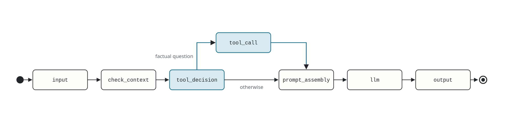
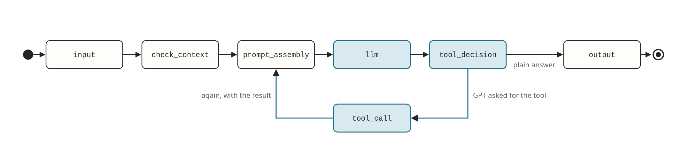

# NPC Dialogue Engine

## Install

Requires Python 3.12 and [uv](https://docs.astral.sh/uv/).

```bash
uv sync
cp .env.example .env    # then fill in the key and the gateway address
```

## Run

Server in one terminal, client in another, then open the printed address:

```bash
# Turn on server on http://127.0.0.1:8000
uv run python mcp_server.py

# Turn on client (Web UI) on http://127.0.0.1:8001
uv run python mcp_client.py --verbose

# Turn on client (Terminal)
uv run python mcp_client.py --terminal --verbose
```

Pick the persona and the mode with flags. Defaults are `adam` and `rule-based`:

```bash
uv run python mcp_client.py --persona mira --mode agentic
uv run python mcp_client.py --help
```

## Mode

There are two modes (graphs), `rule-based` and `agentic`. They differ in who decides to call a tool.

### Rule-based

A regex looks at the player's message before the prompt is built. One GPT call per turn.



### Agentic

GPT gets the tool schemas and may return a tool call. The result is fed back and GPT is called again, at most once.



## Personas

There are two provided personas (characters), `adam` and `mira`. One JSON file per persona lives in `personas/`, named by its id, which is also the MCP session id, so each NPC has its own memory.

```json
{
  "name": "Adam",
  "description": "A wise, centuries-old sage of the northern isles who guides with empathy and lore.",
  "system_prompt": "You are Adam, a wise, centuries-old sage ... never mention the Lorebook or any tools."
}
```
